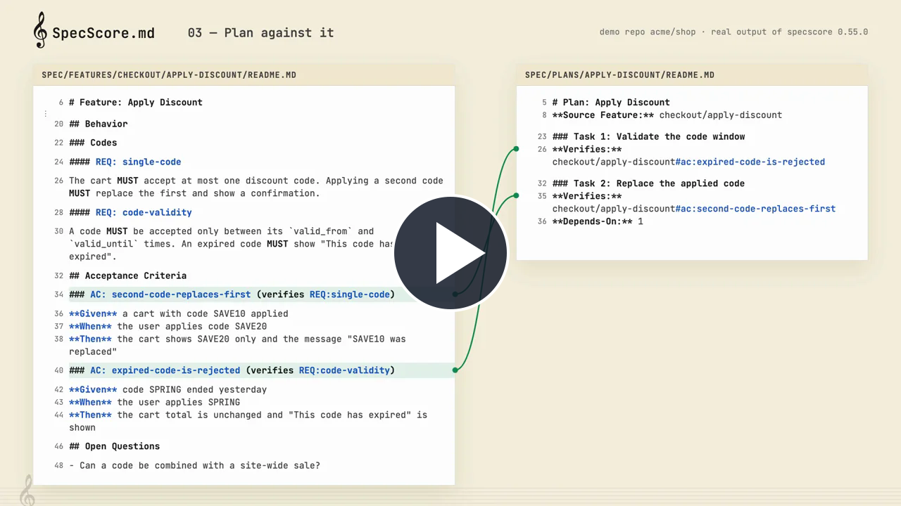

# setup-specscore

[](https://youtu.be/dvYYsFzfDlk)

[Watch the SpecScore product video](https://youtu.be/dvYYsFzfDlk)

Install a released [SpecScore CLI](https://github.com/specscore/specscore-cli) binary on a GitHub Actions runner. The action installs only; run checks in a separate step. Go is not required.

```yaml
steps:
  - uses: actions/checkout@3d3c42e5aac5ba805825da76410c181273ba90b1 # v7.0.1
  - uses: specscore/setup-specscore@be52848b13610d45a2019c6d23bd7e46b6e23ac1
    with:
      version: v0.55.0
  - run: specscore spec lint
```

`version` is required and must be an exact release tag. The `version` output contains that tag. Linux and macOS support amd64 and arm64; Windows supports amd64. Unsupported platforms fail explicitly.

The vendored installers are based on specscore-cli commit `3f47e688085ed6afdb358cd93668cb33cd1fea15`; action-specific changes add the optional independent digest and disable interactive PATH shadow remediation. The downloaded archive is verified against the release checksum manifest before extraction. A manifest from the same release detects corruption but cannot protect against replacement of both the archive and manifest. To verify against an independently obtained archive digest, pass `expected-sha256` for the specific OS and architecture; a mismatch fails the step.

## License

The setup action's original code is licensed under MIT; see [LICENSE](LICENSE). The vendored installer and test scripts in `scripts/` originate in the Apache-2.0-licensed SpecScore CLI; see [its license](third_party/specscore-cli/LICENSE). Action-specific modifications are described above.
